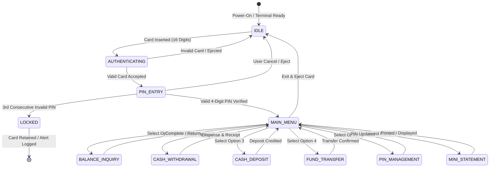

# Software Requirements Specification (SRS)
## NexBank ATM-X700 Core Terminal System
**Document Version:** 2.4.0  
**Target System:** Automated Teller Machine (ATM) Core Terminal  
**Compliance Standard:** ISO/IEC/IEEE 29148:2018 & PCI-DSS v4.0

---

## 1. Introduction

### 1.1 Purpose
This document provides a comprehensive, rigorous functional and non-functional specification for the **NexBank ATM-X700 Automated Teller Machine (ATM)** system. The purpose is to establish baseline requirements for cardholder authentication, transaction processing (cash withdrawal, deposit, fund transfer, balance inquiry, PIN management), session security, and hardware peripheral interactions.

### 1.2 System Scope
The NexBank ATM-X700 terminal operates as an unattended self-service banking terminal connected to the Core Banking System (CBS) switch. The terminal processes cardholder requests, coordinates with hardware dispensing and receiving units, and maintains transaction integrity adhering strictly to ACID principles (Atomicity, Consistency, Isolation, Durability).

---

## 2. System Architecture & State Machine

The ATM system operates on a deterministic finite state machine (FSM):

---

## 3. Functional Requirements Specifications

### REQ-01: Card Reader Interface & Validation
* **REQ-01.1 [Format]:** The ATM card reader shall accept magnetic-stripe or EMV chip cards bearing a standard 16-digit Primary Account Number (PAN).
* **REQ-01.2 [Input Sanitization]:** Non-numeric characters, cards shorter or longer than 16 digits, or blank inputs shall be rejected immediately with an error message: `"ERROR: Invalid Card. Card number must be 16 numeric digits."`
* **REQ-01.3 [Card Status Check]:** The system shall verify the card against the active accounts database. If the card is flagged as blocked (`isBlocked = true`), the system shall reject the card, retain the physical card if hardware allows, and display `"SECURITY ALERT: CARD BLOCKED"`.

### REQ-02: Cardholder Authentication & PIN Lockout Rules
* **REQ-02.1 [PIN Specifications]:** The Personal Identification Number (PIN) must be strictly 4 numeric digits ($0000$ to $9999$).
* **REQ-02.2 [Brute-Force Lockout Threshold]:** To prevent brute-force attacks in accordance with PCI-DSS:
  * The system shall allow a maximum of **3 consecutive invalid PIN attempts**.
  * Upon entering an invalid PIN on the **3rd consecutive attempt**, the system must immediately lock the account/card (`isBlocked = true`), retain the card, transition to the `LOCKED` state, and forbid any further transaction attempts.
* **REQ-02.3 [Counter Reset]:** Upon any successful PIN authentication before reaching the threshold, the failed attempts counter must be reset immediately to zero ($0$).

### REQ-03: Cash Withdrawal Rules & Cash Dispenser Management
* **REQ-03.1 [Allowed Denominations]:** The ATM cash dispenser only stocks \$20 and \$50 banknotes. All requested withdrawal amounts must be valid combinations of \$20 or \$50 notes (i.e. amount must be divisible by 20 or 50, with valid combinations such as \$40, \$50, \$60, \$70, \$80, \$90, \$100, etc. Arbitrary amounts such as \$13, \$37, \$45 are strictly prohibited).
* **REQ-03.2 [Single Transaction Limit]:** The maximum allowable withdrawal in a single transaction is **\$500.00**.
* **REQ-03.3 [Cumulative Daily Limit]:** The maximum cumulative withdrawal per card per business day is **\$1,000.00**. Any withdrawal that would cause the day's cumulative total (`dailyWithdrawn + amount`) to exceed \$1,000.00 must be rejected.
* **REQ-03.4 [Positive Amount Validation]:** The withdrawal amount must be strictly greater than zero ($amount > 0$). Negative values or zero must be rejected.
* **REQ-03.5 [Minimum Maintaining Balance]:** The account requires a mandatory minimum maintaining balance of **\$50.00**. If a withdrawal would reduce the customer's account balance below \$50.00 ($balance - amount < 50.00$), the transaction must be rejected with: `"ERROR: Insufficient funds. Balance cannot drop below required $50.00."`

### REQ-04: Cash Deposit Validation
* **REQ-04.1 [Maximum Deposit Limit]:** The maximum cash deposit per transaction is **\$2,000.00**.
* **REQ-04.2 [Immediate Ledger Update]:** Upon deposit confirmation, the customer's ledger balance shall be credited immediately.
* **REQ-04.3 [Transaction Record]:** The transaction history must record an entry with timestamp, type `"Cash Deposit"`, credited amount ($+\$amount$), and resulting balance.
* **REQ-04.4 [Strict Positive Input]:** Deposit amounts must be strictly positive numeric values ($amount > 0$). Negative deposits must be rejected at input validation.

### REQ-05: Inter-Account Fund Transfer
* **REQ-05.1 [Destination Validation]:** The transfer destination must be an active, valid 16-digit account. **The destination account must not be identical to the source account** (self-transfers are invalid and must be rejected).
* **REQ-05.2 [Maintaining Balance Enforcement]:** The sender's balance after transfer deduction must not breach the minimum maintaining balance of \$50.00.
* **REQ-05.3 [Atomicity]:** Deduction from the sender and crediting to the recipient must occur as a single atomic unit of work (ACID transaction).

### REQ-06: PIN Change Protocol
* **REQ-06.1 [Current Authentication]:** The cardholder must verify their identity by providing their current (old) PIN before entering a new PIN.
* **REQ-06.2 [Length & Format]:** The new PIN must be exactly 4 numeric digits.
* **REQ-06.3 [History / Difference Rule]:** The new PIN **must not be identical** to the current PIN ($newPin \neq oldPin$).
* **REQ-06.4 [Double Confirmation]:** The user must re-enter the new PIN; the system shall update the PIN only if `newPin === confirmNewPin`.

### REQ-07: Session Management, Masking & Sensitive Data Protection
* **REQ-07.1 [Masking]:** All PIN inputs must be masked on screen (`type="password"`).
* **REQ-07.2 [DOM & Client-Side Security]:** No sensitive authentication data (cleartext PIN, unmasked PAN, CVV) shall be written to browser DOM attributes, debug objects, or client-accessible metadata (PCI-DSS Requirement 3.4).
* **REQ-07.3 [Session Termination]:** Upon clicking Exit, Cancel, or upon session timeout, all customer credentials and temporary transaction states must be purged from active memory and the terminal returned to the `IDLE` state.

### REQ-08: Receipt & Mini-Statement Generation
* **REQ-08.1 [Masked Account Number]:** Receipts and mini-statements shall only display the last 4 digits of the card number (e.g. `****7865`).
* **REQ-08.2 [Mini-Statement Depth]:** The mini-statement shall list the last 5 transactions in reverse chronological order with date/time, description, amount, and running balance.

---

## 4. Verification & Testing Strategy
To guarantee software quality and compliance, an automated test harness built using **Selenium WebDriver (Python)** shall execute test cases corresponding to each requirement. Deviations from these requirements represent software defects and must be logged in the Software Defect Report.

